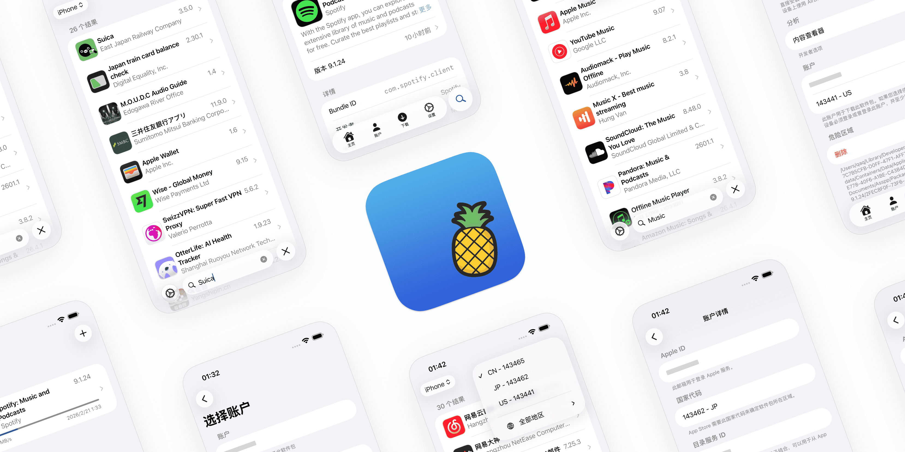

# NVDAppleIDDownload

> **NVDAppleIDDownload của nvd29u1, dựa trên Asspp của Lakr233 (MIT).**
> Tải file IPA từ App Store ngay trên iPhone, không cần máy tính. Đăng nhập bằng
> Apple ID sở hữu app, chọn app, tải về rồi cài trực tiếp trên máy.
>
> Gốc: https://github.com/Lakr233/Asspp — bản 4.2.2, giấy phép MIT,
> Copyright (c) 2025 Lakr Aream. Mọi quyền và ghi công của tác giả gốc được giữ
> nguyên trong file `LICENSE`.
>
> **Phiên bản riêng 2.0 (từ build 5):** từ build 5 trở đi app dùng version
> riêng **2.0** thay vì version gốc Asspp 4.2.2 (màn chào mừng hiện "2.0 5");
> số build giữ nguyên là **5**, không reset về 1 — quy trình build của repo
> không bắt reset build (script CI không đụng tới version, `MARKETING_VERSION`
> nằm ở `Configuration/Version.xcconfig` và cả 2 cấu hình Debug/Release của
> target trong `Asspp.xcodeproj/project.pbxproj`).
>
> **Giao diện NVD:** nền mận đậm, logo lợn xanh, tiếng Việt.
>
> **Máy chủ manifest mặc định:** https://nvd-manifest.nguyenvietdung156195.workers.dev
> (worker Cloudflare riêng của nvd29u1 — chỉ tạo file manifest, file IPA không
> đi qua máy chủ này). Xoá trắng ô "Cài đặt app" trong Cài đặt để về lại máy chủ
> local trên máy (cần cài đặt và tin cậy chứng chỉ "NVD Local Installation CA").
>
> **Giới hạn cần biết:**
> - Tải IPA từ App Store bắt buộc phải đăng nhập Apple ID sở hữu app đó.
>   Không tải được IPA "sạch" đã giải mã mà không cần đăng nhập.
> - File IPA tải về vẫn mã hoá FairPlay, chưa giải mã để cài qua SideStore.
>   Muốn có IPA đã giải mã phải giải mã trên thiết bị đã jailbreak hoặc bằng
>   cách khác ngoài phạm vi app này.
> - Nên dùng Apple ID phụ lần đầu.
> - **Xuất file IPA (4.2.2 build 4):** app đã tải xong thì ở tab Lượt tải và
>   màn hình chi tiết app có nút "Tải IPA về máy" — bấm để mở Share Sheet,
>   lưu file `.ipa` vào Tệp hoặc chia sẻ qua AirDrop / app khác. Chỉ xuất
>   đúng file đã tải (FairPlay, gắn với Apple ID đã mua), không giải mã,
>   không đổi tên bundle. File chưa tải xong hoặc đã bị xoá thì nút mờ đi.
> - **Nhập vào Đã mua (4.2.2 build 4):** ở màn chi tiết app miễn phí có nút
>   "Nhập vào Đã mua" — chỉ mua license để app vào danh sách Đã mua của
>   Apple ID đó, không tải file IPA. App trả phí không dùng được nút này.
> - **Lịch sử phiên bản (4.2.2 build 4):** sửa lỗi chọn phiên bản cũ báo
>   "AuthenticationError 0" — lỗi đó là "không tìm thấy tài khoản theo id
>   đã chọn" (vd. đăng xuất rồi đăng nhập lại bằng Apple ID khác). App giờ
>   tự dùng tài khoản đang đăng nhập cho region đó, thử lại tối đa 3 lần
>   khi Apple trả lỗi tạm thời, và báo lỗi tiếng Việt rõ ràng nếu vẫn lỗi.
> - **Vùng tài khoản (2.0 build 5):** màn chi tiết app liệt kê mọi tài khoản
>   đã đăng nhập (đúng vùng trước, khác vùng sau, có ghi mã vùng và chữ
>   "khác vùng"); không có tài khoản đúng vùng thì tự chọn tài khoản đang
>   đăng nhập và hiện cảnh báo vùng màu cam. Nút "Yêu cầu tải" và "Nhập vào
>   Đã mua" chỉ mờ khi chưa đăng nhập tài khoản nào.
> - **Nhập vào Đã mua khác vùng (2.0 build 5):** 1 tài khoản không mua được
>   license ở vùng khác — Apple chỉ cho nhập vào Đã mua ở đúng vùng của tài
>   khoản (giới hạn phía Apple, lệnh purchase của ApplePackage không có tham
>   số vùng). Nút vẫn bấm được khi lệch vùng (app có ở cả hai vùng thì vẫn
>   nhập được); nếu Apple từ chối vì app không có trong cửa hàng vùng đó thì
>   app báo rõ bằng tiếng Việt và gợi ý thêm tài khoản đúng vùng ở tab Tài khoản.
> - **Đợt 3 (2.0 build 8):** Lịch sử phiên bản hiện dung lượng IPA + ghi chú
>   cập nhật (khi Apple trả trong metadata tải; bản mới nhất tra thêm qua
>   iTunes Lookup), bấm giữ 1 dòng để copy số version / version ID; app đã
>   tải xong có nút "Giữ phiên bản này" (đã giữ thì tab Lượt tải không nhắc
>   bản mới nữa). Màn "Đang theo dõi": theo dõi app ở màn chi tiết, xem giá
>   hiện tại + lịch sử giá (tra qua iTunes Lookup công khai khi mở màn,
>   không chạy nền). Mục "So giá các vùng" ở màn chi tiết: so giá app ở các
>   vùng ưa thích đã chọn, xếp từ rẻ đến đắt, mỗi vùng hiện theo tiền tệ của
>   vùng đó (chưa quy đổi sang VNĐ). Tab Lượt tải: app đã tải có bản mới trên
>   Store thì hiện nhãn "Có bản mới" (chỉ tra khi mở tab). Chia sẻ IPA qua
>   Wi-Fi: bật trong Cài đặt rồi mở màn chia sẻ, máy tính cùng Wi-Fi gõ địa
>   chỉ IP:cổng để tải IPA đã tải xong; rời màn là máy chủ tắt. Màn chi tiết
>   gói đã tải có nút "Xem nội dung IPA" (liệt kê file trong ZIP, xem trước
>   file text nhỏ / ảnh, trích 1 file ra Share Sheet). Khoá app bằng Face ID /
>   Touch ID / mật khẩu trong Cài đặt (LocalAuthentication, không lưu mật khẩu;
>   mở app lên là khoá, rời app thì khoá lại). File `altstore-source.json` ở
>   root repo để cài/cập nhật qua SideStore/AltStore/Feather (xem dưới).
>   **Chưa làm được: tải PKG Mac** — thư viện ApplePackage (fork nvd29u1) chỉ
>   có EntityType iPhone/iPad/AppleTV, không có endpoint tải PKG Mac App Store;
>   muốn làm phải thêm giao thức mới vào fork rồi kiểm chứng, để đợt sau.
> - **Cài qua AltStore source (từ build 8):** thêm URL
>   `https://raw.githubusercontent.com/nvd29u1/NVDAppleIDDownload/main/altstore-source.json`
>   vào SideStore / AltStore / Feather (Add Source), app sẽ hiện trong nguồn
>   để cài và cập nhật. Mỗi lần phát hành bản mới (tag release) phải cập nhật
>   `version`, `versionDate`, `versionDescription` và `downloadURL` trong
>   `altstore-source.json` theo đúng tag/asset của release đó — hiện file đang
>   trỏ tới asset `v2.0.8/NVDAppleIDDownload.ipa` (chưa có tag này thì link
>   chưa tải được cho tới khi tag release).
- Đăng nhập báo `authentication failed: HTTP 204`: máy chủ Apple trả về
  trống, chưa xét mật khẩu — không phải sai mật khẩu hay thiếu mã 2FA.
  Từ 06/11/2026 Apple yêu cầu xác minh thiết bị (Anisette/ADI) khi đăng
  nhập App Store, mà thư viện ApplePackage 2.0.3 chưa có; app sẽ tự thử
  lại 3 lần với phiên mới. Lỗi "failed to retrieve redirect location"
  cũng cùng họ này: Apple trả về chuyển hướng nhưng không có địa chỉ
  chuyển tiếp, tức là từ chối yêu cầu trước khi xét tài khoản — không
  phải sai mật khẩu. Kiểm tra lại email đã gõ đúng chưa (đúng là
  ...@gmail.com, không phải ...@gamil.com) rồi thử lại. Nếu vẫn lỗi: kiểm tra tài khoản trong App
  Store chính thức, thử mạng khác, hoặc dùng ipatool 2.8.1 trên máy tính.

---

# NVDAppleIDDownload

**The Ultimate Multi-Region App Store Manager.**

NVDAppleIDDownload is a powerful client designed for users who need to manage **multiple Apple IDs** across **different countries and regions**. Switch stores instantly, download apps from anywhere, and manage your IPA library—all without logging out of your device.

[简体中文 🇨🇳](./Resources/i18n/zh-Hans/README.md)

## ✨ Why NVDAppleIDDownload?

- **🌍 Multi-Region Access**: Browse and search the US, Japan, China, or any other App Store region seamlessly. No more switching system accounts just to check an app.
- **👥 Multi-Account Support**: Add unlimited Apple IDs. NVDAppleIDDownload automatically uses the correct account for the store you are browsing.
- **📦 IPA Management**: Download official, signed IPAs directly from Apple's servers for backup or sideloading.
- **⏪ History Versions**: Need an older version of an app? NVDAppleIDDownload makes it easy to find and download previous releases.
- **📱 Cross-Platform**: Native experience on both **iOS** and **macOS**.

## 📥 Installation

### iOS

#### Option 1: Auto-Build & Sign (Recommended)

Fork this repository to automatically build and sign the app with your own developer certificate. This gives you a permanent **OTA installation link** that stays up-to-date with the latest changes.

👉 **[Setup Guide](./Resources/Document/FORK_AUTOBUILD_GUIDE.md)**

#### Option 2: Manual Install

1.  Download the latest `.ipa` from [Releases](https://github.com/nvd29u1/NVDAppleIDDownload/releases).
2.  Sign and install using your preferred tool (e.g., SideStore, AltStore, TrollStore, or other signing service).

### macOS

1.  Download the latest `.zip` from [Releases](https://github.com/nvd29u1/NVDAppleIDDownload/releases).
2.  Unzip and move `NVDAppleIDDownload.app` to your Applications folder.
3.  **First Run and Trusting the App (Recommended)**:
    1.  Try double-clicking to open the app. If you see "App can’t be opened because the developer cannot be verified" or a similar message:
        - In Finder, locate `NVDAppleIDDownload.app`, **Control-click** (or right-click) the app and choose **Open**, then click **Open** again in the dialog. This will create a one-time trust exception for the app.
    2.  If Control-clicking does not work or the app is still blocked:
        - Open **System Settings** -> **Privacy & Security** (or System Preferences -> Security & Privacy on older macOS). In the General/Security section, look for the blocked app and click **Open Anyway** or **Allow**. You may need to enter an administrator password.
    3.  Recommendation: Download from this repository's Releases and verify the release details to ensure the source is trusted before trusting and opening the app.

    > These steps follow macOS Gatekeeper practices and help minimize security risks while allowing you to run unsigned or self-signed apps.

## 🛠 Requirements

- **iOS**: iOS 16.0 or later.
- **macOS**: macOS 15.0 or later.
- **Apple ID**: Required to communicate with App Store APIs.

## 🚨 Special Notice

NVDAppleIDDownload utilizes the same underlying communication protocol as `ipatool`. According to community speculation (unverified), previous outages of this protocol were likely caused by:
1. Widespread usage triggering Apple's risk control mechanisms.
2. Protocol modifications following the patching of an iCloud security vulnerability.
3. Adjustments to Apple's front-end gateways, which now enforce stricter traffic allocation and request validation.

Given the increasingly strict management of these APIs, **if the protocol becomes invalid again in the future, this project may not be able to provide further fixes.**

**⚠️ Important Security Warnings:**
1. **Protect your GUID:** Please treat your device GUID as a highly sensitive password. Never share or leak it to anyone.
2. **Do NOT use your primary Apple ID:** We strongly advise using a secondary or burner account with this tool. If your account is banned by Apple, it could potentially result in an unremovable Activation Lock on your device (while there are no confirmed cases of this happening yet, we cannot make any guarantees).

## ⚠️ Disclaimer

This project is for educational and research purposes only. It is not affiliated with Apple Inc. Use at your own risk.

## 🥰 Acknowledgments

- [ipatool](https://github.com/majd/ipatool)
- [ipatool-ios](https://github.com/dlevi309/ipatool-ios)
- [localhost.direct](https://get.localhost.direct/)

_`ipatool-ios` and `localhost.direct` are no longer used in the project._

## 📄 License

MIT License. See [LICENSE](./LICENSE) for details.

## Sponsor

[LookInside](https://lookinside-app.com/) helps you inspect a running iOS or macOS app UI from your Mac.

---

Copyright © 2025 Lakr Aream. All Rights Reserved.

